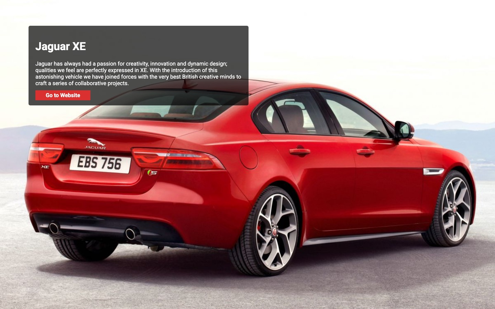
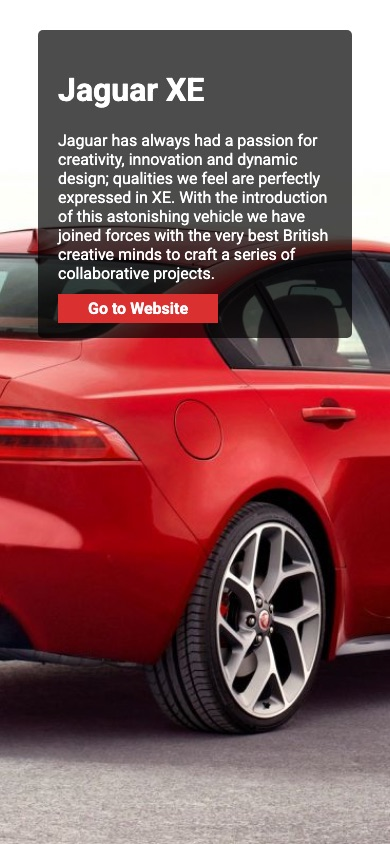

# Landing Jaguar XE

Página de aterrizaje (*landing page*) para el auto Jaguar XE, hecha con HTML y CSS.

- Imagen de fondo a pantalla completa.
- Recuadro semitransparente con el título, una descripción y un botón.
- Diseño adaptable: en pantallas de menos de 600px el recuadro ocupa todo el ancho.

## Capturas de pantalla

Escritorio:



Móvil:



## Cómo verla

No necesita instalación: abre `index.html` en el navegador.

## Estructura

```
index.html           contenido de la página
Style_Jaguar_XE.css  estilos
screenshots/         capturas de pantalla
```
